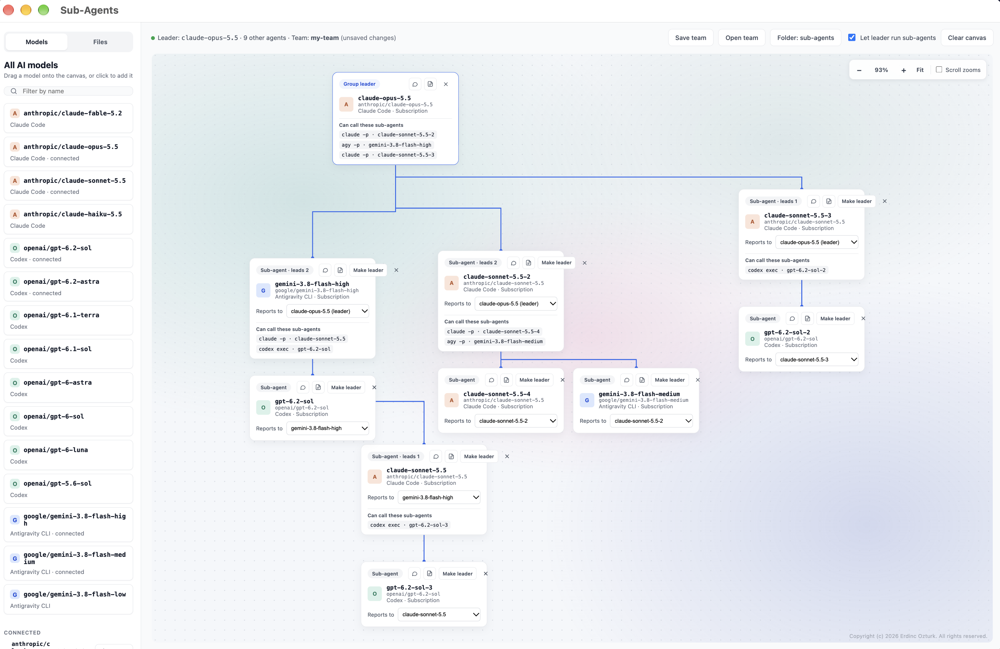

# Sub-Agents

A desktop app for building teams of AI models. Drag models onto a canvas: the first one becomes the group leader, and the others become its sub-agents. Sub-agents can have their own sub-agents too, so a team can be several levels deep.



Each model runs in its own company's tool:

| Models | Runs in | Sign-in |
|---|---|---|
| Claude | Claude Code (`claude`) | Your Claude Code login, or an API key |
| OpenAI | Codex (`codex`) | Sign in with ChatGPT, or an API key |
| Gemini | Antigravity CLI (`agy`) | Your Google sign-in in Antigravity CLI |

## Setup (macOS)

1. Install Node.js (LTS) from nodejs.org.
2. Install the tools for the models you want. Use `sudo` if you get a permission error.

```
npm install -g @anthropic-ai/claude-code
```
```
npm install -g @openai/codex
```
```
curl -fsSL https://antigravity.google/cli/install.sh | bash
```

Then run `agy` once and sign in with your Google account. (Google stopped Google sign-in for personal accounts in Gemini CLI in June 2026; Antigravity CLI replaces it. Gemini CLI still works with a paid API key: use `"harness": "gemini"` in `models.json`.)

3. In this folder:

```
npm install
```
```
npm start
```

## Using it

- **Add a model:** drag it from the list onto the canvas, or click it. The first time, it asks how to sign in. You can add the same model as many times as you want; each copy is its own agent.
- **Agent names:** every box has its own name (shown in bold). Double-click it to rename it, for example `opus-reviewer` and `opus-writer`. Names use letters, numbers, `-`, `_` and `.`; a name that's already taken gets `-2` added. Each agent has its own chat, role file, memory and status; sign-in is shared by all agents of the same model.
- **Moving around (like LTspice):** the canvas has no edges. Drag empty space (or use the middle mouse button) to move around; on a trackpad, two-finger scroll moves and pinch zooms. Cmd+scroll zooms with a mouse. Turn on **Scroll zooms** to make plain scrolling zoom instead. The zoom box in the corner has **−**, the zoom % (click for 100%), **+** and **Fit**. Keys: Cmd + / Cmd − to zoom, Cmd 0 for 100%, Space to fit all agents, arrow keys to move (Shift for bigger steps). Saved teams remember the view.
- **Chat:** the chat button on a box opens that model's chat window. Chats work like Messenger: each one gets its own window along the bottom, up to 3 at a time. Opening a 4th shrinks the oldest into a round bubble on the left; click a bubble to open it again. A blue dot means a new message, orange means it's working. Each window can be minimized, made bigger, resized from its corner, or cleared.
- **Teams:** **Save team** saves the canvas as a file you name (it suggests `your-project/.sub-agents/teams/`). It keeps which models are on the canvas, who reports to whom, where the boxes are, the "Let leader run sub-agents" setting, and each agent's role file. It never stores API keys or sign-ins. **Open team** loads one again; teams in the project folder are also listed in the Files tab. Opening a team never overwrites role files the project already has.
- **Files:** the **Files** tab in the sidebar shows your project folder. Click a file to open it: text and code open in an editor (**Save** or Cmd+S; change the path to save a copy under a new name), images show as pictures, and anything else can be opened in its Mac app. **+** makes a new file or folder. Everything stays inside the project folder.
- **Drafts:** notes and prompts you're working on, kept in `your-project/.sub-agents/drafts/`. **Send to chat** puts a draft into an agent's message box (for other files it adds a note pointing the agent to the file; images get attached). Every reply has a **Save as draft** link.
- **Images:** attach PNG, JPG, GIF or WebP images with the paperclip, by pasting (Cmd+V), or by dropping them onto a chat window. They're saved in `your-project/.sub-agents/attachments/`. Codex gets them with `--image`; Claude Code and Antigravity get the file paths and open the images themselves.
- **Role and memory:** the document button on a box (or in its chat window) opens that agent's role file. See below.
- **Build a team:** each box has a **Reports to** menu. You can also drop a model from the list onto a box to make it that box's sub-agent. **Make leader** changes the top of the team.
- **Folder:** sets the project folder the agents work in. The default is your home folder.

### How sub-agents are called

When you message a model that has sub-agents, it's told it can run:

```
node bin/subagent.js AGENT_NAME "TASK"
```

That script asks the running app to run the sub-agent's own CLI. Because the app does the run, every call is visible:

- the sub-agent's box shows **working…**, then **Last task from … finished** (or **failed**)
- the sub-agent's chat shows the exact task it got and its answer

If a model claims a sub-agent answered but nothing shows up on that sub-agent's box, the call didn't really happen.

### Role files and memory

Each agent has a Markdown role file in the project folder you pick with **Folder**:

```
your-project/.sub-agents/roles/AGENT_NAME.md
```

It has `# Role`, `# Rules` and `# Memory` sections. The app puts the file at the top of every task the agent gets, whether from you or from the agent it reports to. When the agent ends a reply with lines like `REMEMBER: the user prefers TypeScript`, the app adds them under `# Memory`, so the agent sees them next time. You can edit or delete anything in the file, in the app or in any text editor.

### Permissions

- A **Claude** model that leads a team is only allowed to run the sub-agent script. Nothing else is auto-approved.
- A **Codex, Antigravity or Gemini** model that leads a team needs **Let leader run sub-agents** turned on. That runs Codex with `--sandbox danger-full-access`, Antigravity with `--dangerously-skip-permissions` and Gemini CLI with `--yolo`, so **they can run any command without asking**. Only turn it on with a project folder you're OK with them changing.

## Models

Edit `models.json`. Each entry has:

- `id`: the name shown in the app
- `harness`: `claude`, `codex`, `antigravity` or `gemini`
- `model`: the model name that tool expects

To see which names a tool accepts, run it and use its model command (for example, `/model` in Codex). For Antigravity, run `agy models` to list model names. An empty `model` uses Antigravity's default.

## Where things are saved

In the app's user data folder (`~/Library/Application Support/sub-agents` on macOS):

- `state.json`: the canvas, the team layout and which models are connected
- `keys.bin`: API keys, encrypted with the system keychain when available

Chat history isn't saved yet. Role files and memory are saved in the project folder.

## Notes

- Using your own Claude Code or Antigravity login is meant for your own use on your own computer. To use it, run `claude` or `agy` once in a terminal and sign in.
- Using your own Claude Code login is meant for your own use on your own computer. Anthropic doesn't allow apps to offer Claude sign-in to other people, so if you share this app, Claude models should use API keys.

## License

Copyright (c) 2026 Erdinc Ozturk. All rights reserved. See [LICENSE](LICENSE).
